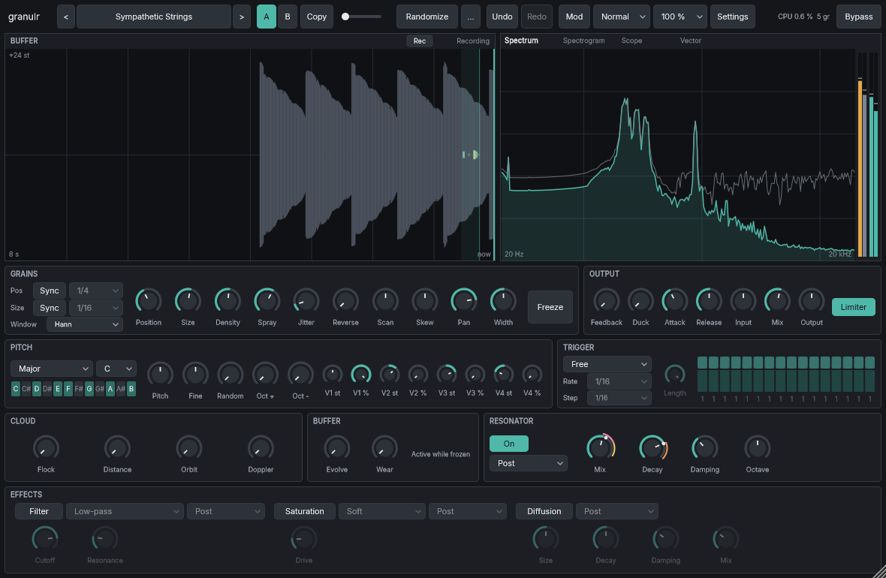
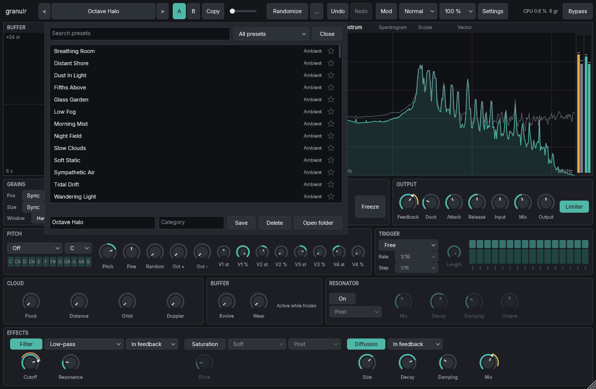

# granulr

A granular effect plugin (VST3, Windows) for live audio: it records the incoming signal into a buffer and replays it as clouds of short grains, with freeze, pitch quantised to a scale, a pattern sequencer, built-in effects and a modulation matrix.


| Spectrum view | Preset browser |
| :- | :- |
|  |  |

The screenshots are produced off screen by `granulr_shot` (software renderer, synthetic test signal). In a host the visualisers are drawn on the GPU.

## What it does

- **Live buffer with freeze.** 8 seconds of stereo audio are always available. Freeze stops recording and lets the grains play the held material for as long as you want.
- **Grains.** Position, size, density, spray, jitter, reverse chance, scan, window shape and skew, pan spread and width. Up to 64, 128 or 256 grains depending on the quality setting (the limit shrinks in proportion to the sample rate above 72 kHz).
- **Four trigger modes.** Free (density in grains per second), Sync (note divisions of the host tempo), Pattern (16 steps with gate, chance and ratchets) and Onset (each attack of the input starts a burst of grains).
- **Cloud behaviour.** Flock makes each grain follow the previous one in position, pitch and pan. Distance, Orbit and Doppler give each grain a depth, a movement across the stereo field and a pitch glide.
- **Living buffer.** While the buffer is frozen, Evolve writes the grain cloud back into it and Wear erodes it at each pass, so a held sound keeps changing instead of looping.
- **Pitch on a scale.** Transposition, random pitch, four harmony voices, octave jumps, and quantisation to a scale (chromatic, major, minor, pentatonics, dorian, phrygian, whole tone, octaves, fifths and octaves, or a custom 12-note mask).
- **Effects.** Filter, saturation and diffusion, each placed either inside the feedback loop or after it. Feedback, ducking against the dry input, and a safety limiter.
- **Resonator.** Six strings tuned to the scale and root of the Pitch section, excited by the grains.
- **Modulation.** Four LFOs, two random sources, an envelope follower, four macros, three sources that listen to the input (Pitch, Brightness, Onset), three that move on their own (Drift, Chaos, Bounce) and a recorded XY gesture, routed through a 32-slot matrix to 49 destinations. Drag a source chip onto a knob to create a route.
- **Presets.** Factory bank, user presets, favourites, A/B slots with morph, undoable randomisation with group locks, and variations that stay close to the current sound (Mutate, Breed A x B, six variations to try).
- **Visualisers.** Grain view over the buffer (you can drag in it), plus spectrum, spectrogram, oscilloscope and vectorscope of the output.
- **Interface zoom** from 100 to 200 % (default 125 %).

Stereo in, stereo out. No MIDI input, no sidechain, no added latency.

### Typical uses

The factory bank holds 159 presets in 16 categories. The 12 classic categories also hold presets that use the cloud, buffer, resonator and listening features:

| Category | Presets | What to expect |
| :- | :- | :- |
| Ambient | 14 | Slow clouds and washes behind the source |
| Glitch | 13 | Tempo-synced chops, ratchets and stutters |
| Shimmer | 12 | Pitched-up feedback through diffusion |
| Frozen | 12 | Held buffer turned into pads (these presets switch Freeze on) |
| Delay | 12 | Grain echoes, synced or loose |
| Chorus | 9 | Thickening, detune and vibrato |
| Reverse | 9 | Backward grains and swells |
| Cascades | 11 | Random pitches quantised to a scale |
| Lo-Fi | 10 | Wobble, band limiting and saturation ("Worn Loop" switches Freeze on) |
| Ducked | 8 | Textures that step back while the source plays |
| Smear | 10 | Blurred transients, pad-like sustain |
| Drones | 11 | Long feedback beds from short material |
| Reactive | 8 | The playing drives the texture: Onset trigger, Pitch, Brightness and Onset sources |
| Swarm | 7 | Flock, Distance, Orbit, Doppler, Drift and Chaos |
| Living | 6 | Frozen buffers that keep changing with Evolve and Wear (these presets switch Freeze on) |
| Strings | 7 | The resonator tuned to a scale |

In every preset Macro 1 and Macro 2 are routed to the controls that matter most for that sound, so turning them is the quickest way to adapt it. Presets are defined in `scripts/build-presets.sh`, which regenerates `presets/factory`.

## Install

1. Download `granulr-<version>-windows-vst3.zip` and its `.sha256` file from the Releases page of this repository.
2. Check the archive (PowerShell): `Get-FileHash .\granulr-<version>-windows-vst3.zip -Algorithm SHA256` and compare with the content of the `.sha256` file.
3. Extract `granulr.vst3` into `C:\Program Files\Common Files\VST3`.
4. Rescan plugins in your host.

Requirements: Windows 10 or 11, 64-bit, a processor with AVX2 (any Intel or AMD desktop processor since about 2015), a VST3 host. OpenGL 3.2 is used for the visualisers when available; otherwise the plugin falls back to software drawing.

The binaries are not code signed. Windows SmartScreen or your browser may warn about the download; the checksum above lets you confirm the file is the one built by the release workflow.

## Build from source

Prerequisites: Visual Studio 2022 or newer (or the Build Tools) with the C++ desktop workload, CMake 3.22 or newer, Git. JUCE 9.0.5 is downloaded automatically at configure time.

```
cmake -S . -B build -A x64
cmake --build build --config Release --parallel
ctest --test-dir build -C Release --output-on-failure
```

By default the build copies `granulr.vst3` into `C:\Program Files\Common Files\VST3`. If that folder is not writable for your account, either run `scripts/install-vst3.ps1` from an elevated PowerShell after the build, or change the behaviour at configure time:

| Option | Default | Effect |
| :- | :- | :- |
| `VST3_INSTALL_DIR` | `C:/Program Files/Common Files/VST3` | Folder the bundle is copied to |
| `GRANULR_COPY_PLUGIN` | `ON` | Set to `OFF` to skip the copy |
| `GRANULR_VERSION` | `0.1.0` | Version written into the plugin |
| `GRANULR_FAST_MATH` | `OFF` | Enables `/fp:fast` |

Build outputs:

- `build/granulr_artefacts/Release/VST3/granulr.vst3`: the plugin
- `build/granulr_artefacts/Release/Standalone/granulr.exe`: standalone application
- `build/Release/granulr_tests.exe`: unit tests (`--verbose` prints the level of every factory preset)
- `build/Release/granulr_bench.exe`: CPU benchmark (`--quick`, `--seconds N`, `--presets`, `--check`)
- `build/Release/granulr_shot.exe`: off-screen screenshots (`--out`, `--zoom`, `--preset`, `--mode`, `--mod`, `--browser`)

## Using it

### Header

Preset name (click to open the browser), previous and next, A and B slots, Copy (copies the active slot to the other one), morph slider between A and B, Randomize, its options menu (amount and group locks), Undo, Redo, Mod (shows the modulation panel), quality, zoom, Settings, CPU and grain count, Bypass.

### Sections

| Section | Controls |
| :- | :- |
| Grains | Position and Size (free in milliseconds or synced to a note division), Density, Spray, Jitter, Reverse, Scan, Window, Skew, Pan, Width, Freeze |
| Output | Feedback, Duck (amount, attack, release), Input, Mix, Output, Limiter |
| Pitch | Scale, root, note strip (custom mask), Pitch, Fine, Random, Oct +, Oct -, four voices (interval and chance) |
| Trigger | Mode, rate, step division, pattern length, step grid (click: gate, drag up or down: chance, number below: ratchets). In Onset mode: Sensitivity and Burst |
| Cloud | Flock, Distance, Orbit, Doppler |
| Buffer | Evolve, Wear (both act while Freeze is on) |
| Resonator | On, placement, Mix, Decay, Damping, Octave |
| Effects | Filter (type, cutoff, resonance), Saturation (type, drive), Diffusion (size, decay, damping, mix), each with its placement |
| Modulation | Source chips, editor of the selected source, macros, matrix |

Scan moves the read position through the buffer over time; it is most useful when the buffer is frozen.

### Modulation

- Drag a source chip onto a knob to add a route.
- Alt + drag on a knob changes the depth of the selected source for that knob.
- Right-click a knob for its routes, value entry and reset.
- The coloured ring around a knob shows the modulated value in real time.

### Sources that listen and sources that move

| Source | What it does |
| :- | :- |
| Pitch | Follows the note played at the input, two octaves around middle C. Holds while there is no clear note |
| Brightness | Follows how bright the input is |
| Onset | Jumps to full on each attack, then falls back with the Envelope release time |
| Drift | Random walk. Pull brings it back to the centre |
| Chaos | Lorenz attractor: never repeats, switches sides without warning. Shape makes it roll instead |
| Bounce | A ball dropped again when it rests or on an attack |
| Gesture X, Gesture Y | A movement you drew in the buffer view, replayed in a loop |

### Buffer view

- Drag in the view to set Position (across) and Pitch (up and down). Hold Shift to leave the pitch alone.
- Alt + drag draws the range the grains read: it sets Position and Spray.
- Rec arms the recording: the next drag is recorded, then replayed in a loop as the Gesture sources. Routes from Gesture X to Position and from Gesture Y to Pitch are created if they do not exist. Right-click Rec to erase the gesture.
- The gesture is saved with the project and with presets, and plays with the editor closed. Its playback speed is the Gesture Rate parameter, available to the host.
- With Distance above zero, far grains are drawn smaller and fainter.

### Variations

The menu next to Randomize holds three ways to get new sounds close to the current one. They use the amount and the locked groups of that menu, and each one is a single undo step.

- **Mutate:** small moves of every unlocked control; routings keep their destinations.
- **Breed A x B:** crosses slots A and B. Each group (grains, pitch, effects, modulation) mostly follows one parent.
- **Make 6 variations:** prepares six mutations to try one after the other, and Back to original.

### Scale quantisation

When a scale is selected, granulr tracks the pitch of the incoming audio and moves each grain to the nearest note of the scale, so the result lands on absolute scale notes. When the input has no clear pitch (noise, drums, dense chords), it falls back to quantising the transposition interval, which assumes the input is already in the chosen key.

### Shortcuts

| Keys | Action |
| :- | :- |
| Ctrl + plus, Ctrl + minus, Ctrl + wheel | Zoom in and out |
| Ctrl + 0 | Zoom back to 125 % |
| Ctrl + Z, Ctrl + Y | Undo, redo |
| Ctrl + D | Diagnostics overlay (frame rate, frame time, renderer, CPU) |

Some hosts keep keyboard shortcuts for themselves; every action is also available from the header.

### Settings

- **Frame rate:** Display sync (follows the monitor refresh rate), Unlimited (no frame rate limit, GPU only) or a fixed cap.
- **GPU rendering:** on by default. Turn it off to draw everything in software.
- **Show diagnostics**, **Open preset folder** and **About granulr**.

The zoom chosen last becomes the default for new instances.

Changes to the modulation matrix made by hand and gesture recordings are not part of undo history; preset loads, randomisation and variations are (undo does not bring a replaced gesture back).

### Where files are stored

| What | Location |
| :- | :- |
| User presets | `Documents\granulr\Presets\*.granulrpreset` |
| Global settings and favourites | `%APPDATA%\granulr\settings.xml` |

Factory presets are embedded in the plugin.

## Performance

Measured with `granulr_bench` on a Ryzen 7 9800X3D, one core, as processing time divided by block duration, blocks of 128 samples. Full output: [docs/benchmark-9800x3d.txt](docs/benchmark-9800x3d.txt).

| Case | 48 kHz | 96 kHz | 192 kHz |
| :- | :- | :- | :- |
| Default settings, mean | 0.32 % | 0.43 % | 0.72 % |
| Worst case (High quality, maximum density, every effect and every cloud feature on), mean | 6.7 % | 10.3 % | 11.7 % |
| Worst case, 99th percentile | 7.9 % | 14.4 % | 17.6 % |
| Worst case with a frozen, evolving buffer, mean | 7.3 % | 10.0 % | 11.2 % |

Bypassed, the plugin uses about 0.2 % at 48 kHz. Each of the 159 factory presets stays under 2.0 % mean at 96 kHz (99th percentile under 3 %, except one preset measured at 5.9 %). These figures move by a few points from one run to the next. In this run, the one case above 20 % at the 99th percentile is the worst case at 48 kHz with blocks of 1024 samples (22.1 %, mean 8.0 %). Isolated single blocks can take longer than the mean (see the "worst" column of the benchmark output); their cause has not been isolated.

When the input and the grain tail are silent the engine goes idle. With the editor closed, no analysis is done for the visualisers.

## Debugging aid

Setting the environment variable `GRANULR_GL_CAPTURE` to a PNG file path before starting the host or the standalone application makes the editor save one image read back from the OpenGL frame shortly after opening. It is meant for checking the GPU rendering path on machines where normal screen capture does not work.

## Project structure

```
CMakeLists.txt            project, JUCE fetch, plugin and tool targets
src/plugin/               processor and editor
src/params/               parameter IDs and layout
src/dsp/                  grain engine, pitch tracking and quantisation, effects
src/mod/                  modulation sources and matrix
src/state/                presets, global settings
src/shared/               audio to interface bridge
src/gui/                  theme, look and feel, controls, visualisers, panels
presets/factory/          factory presets (generated by scripts/build-presets.sh)
assets/fonts/             Inter (SIL Open Font License)
tests/                    unit tests
bench/                    CPU benchmark
scripts/                  install script, preset generator, screenshot tool
.github/workflows/        release build
docs/                     plan, benchmark output, screenshots
```

## Releases

Publishing a GitHub release runs `.github/workflows/release.yml`, which builds the plugin on Windows, runs the tests and attaches `granulr-<tag>-windows-vst3.zip` and its SHA-256 file to the release. The workflow can also be started by hand; the archive is then kept as a workflow artifact.

## Licence

granulr is free software under the GNU Affero General Public License, version 3 or later. See [LICENSE](LICENSE).

It is built with [JUCE](https://juce.com) 9, used under its AGPLv3 option. The interface uses the Inter typeface under the SIL Open Font License ([assets/fonts/Inter-LICENSE.txt](assets/fonts/Inter-LICENSE.txt)). VST is a registered trademark of Steinberg Media Technologies GmbH.
